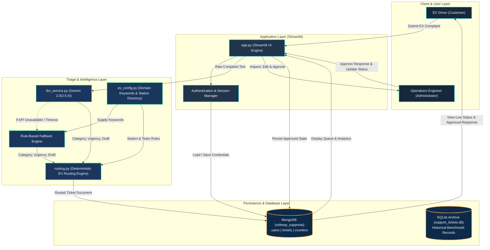
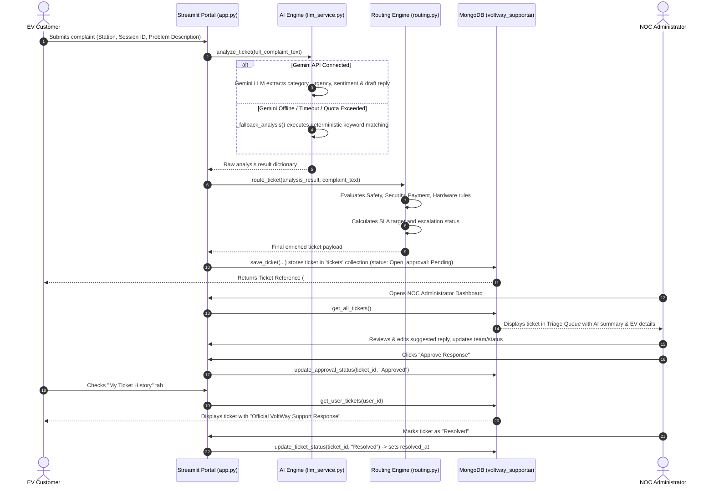

# SupportAI – VoltWay Networks
### AI-Powered EV Charging Customer Support and Ticket Management System

[](https://www.python.org/)
[](https://streamlit.io/)
[](https://www.mongodb.com/)
[](https://ai.google.dev/)
[](#k-ai-and-fallback-mechanism)
[](#visual-identity--design-system)

---

## Table of Contents

- [A. Project Header](#a-project-header)
- [B. Project Overview](#b-project-overview)
- [C. Problem Statement](#c-problem-statement)
- [D. Key Features](#d-key-features)
- [E. System Architecture](#e-system-architecture)
- [F. Technology Stack](#f-technology-stack)
- [G. Project Folder Structure](#g-project-folder-structure)
- [H. Ticket Processing Workflow](#h-ticket-processing-workflow)
- [I. EV-Specific Business Use Case](#i-ev-specific-business-use-case)
- [J. Database Design](#j-database-design)
- [K. AI and Fallback Mechanism](#k-ai-and-fallback-mechanism)
- [L. Installation and Setup](#l-installation-and-setup)
- [M. Running the Application](#m-running-the-application)
- [N. Testing and Verification](#n-testing-and-verification)
- [O. Screenshots](#o-screenshots)
- [P. Future Scope](#p-future-scope)
- [Q. Limitations](#q-limitations)
- [R. Author and Project Information](#r-author-and-project-information)

---

## A. Project Header

**SupportAI – VoltWay Networks** is an intelligent, domain-tailored customer support and ticket management platform designed for electric vehicle (EV) charging network operators. It merges Google Gemini large language model capabilities with a zero-latency deterministic rule engine to classify charging failures, assess urgency, route complaints to specialized engineering departments, track SLAs, and generate suggested customer responses requiring human-in-the-loop approval.

---

## B. Project Overview

VoltWay Networks is a fictional public electric vehicle charging operator managing AC charging points and DC fast-charging hubs across Pune, Mumbai, and Nashik. EV charging infrastructure frequently experiences hardware, software, and payment frictions that strand motorists and demand immediate operational intervention.

SupportAI provides an end-to-end operations platform that:
1. **Intelligently Triages Customer Complaints**: Evaluates free-text customer complaints and extracts structured issue categories, customer sentiment, and operational urgency.
2. **Automates Support Department Routing**: Deterministically maps tickets to Payment Support, Technical Operations, Network Operations, Finance Support, Account Support, Safety Operations, or General Support.
3. **Enforces Resolution SLAs**: Calculates target resolution deadlines based on department and escalation severity (ranging from immediate human intervention for safety hazards to 8 hours for general inquiries).
4. **Drafts Empathetic Suggested Replies**: Generates context-aware customer responses while enforcing a strict **human-in-the-loop** guardrail—ensuring that operations administrators inspect, edit, and approve every reply before it is released to the driver.
5. **Maintains Operational Reliability**: Features an internal rule-based classification fallback engine that guarantees uninterrupted ticket intake and triage even when external LLM APIs face network disconnection, rate limiting, or service downtime.

---

## C. Problem Statement

### Challenges in Public EV Charging Infrastructure
- **Payment & Charging Session Mismatches**: Drivers scan a QR code, UPI or card payment is deducted, but the charger fails to initiate power delivery, leaving the driver frustrated and out of pocket.
- **Physical Connector & Cable Faults**: High-power CCS2/Type 2 connectors jam, refuse to unlock from the vehicle socket, or throw communication errors (`PLC handshake failed`, `connector error`).
- **Mid-Session Charging Dropouts**: Thermal overheating, voltage fluctuations, or station communication faults cut charging sessions prematurely.
- **Charger & Station Unavailability**: Offline charging stations, network dead zones, or occupied bays prevent charging without advance warning.
- **Financial & Duplicate Billing Errors**: Incomplete session terminations result in double deductions or delayed transaction adjustments.
- **Account Security & Unauthorized Transactions**: Stolen credentials or app session hijacking lead to unauthorized charging billing.
- **Physical & Electrical Safety Hazards**: Overheating cables, burning smells, sparking connectors, or water ingress pose critical electrical shock and fire hazards.
- **Manual, Delayed Customer Support**: Generic support ticketing desks lack EV domain context, routing technical charger malfunctions to general customer care queues and resulting in multi-day resolution delays for stranded drivers.

### How SupportAI Solves These Challenges
- **Instant Domain-Aware Classification**: Differentiates between physical charging hardware issues, network outages, payment discrepancies, and account takeovers in milliseconds.
- **Safety First Automated Escalation**: Bypasses routine queues when fire, smoke, sparking, or electrical shock terms are detected, escalating the ticket to Safety Operations with an immediate emergency advisory.
- **Automated Department Dispatch**: Eliminates manual triage by routing tickets directly to the responsible team (e.g., connector faults to Technical Operations, double charges to Payment Support).
- **Human-Controlled Response Delivery**: Keeps customer communication professional, empathetic, and accurate without hallucinatory claims regarding completed refunds or repairs.

---

## D. Key Features

SupportAI implements a complete set of customer and administrator capabilities:

- **Customer Dashboard**:
  - Secure registration and login with local device credential persistence ("Remember Me").
  - Intuitive complaint submission form with live station directory selection.
  - Interactive technical station card displaying Area, City, Connector Type (`DC Fast Charger` vs `AC Charger`), Power Rating (`kW`), and Operational Status (`Operational` vs `Maintenance`).
  - Metadata capture for Transaction ID, Session ID, and EV Vehicle Model (e.g., *Tata Nexon EV*, *MG ZS EV*).
  - Dedicated **My Ticket History** tab tracking live status badges (`Open`, `In Progress`, `Awaiting Customer`, `Resolved`, `Closed`), urgency levels, SLA targets, and official approved responses.
- **Administrator NOC Control Panel**:
  - Live KPI metric cards: Total Tickets, Awaiting Approval, Escalated Incidents, Active Tickets, Resolved Tickets.
  - Multi-tab layout: **Live Overview** for rapid triage, **Ticket Queue & Triage** for full management, and **Network Analytics & SLA** for performance tracking.
  - Interactive filters by Ticket Urgency (`Critical`, `High`, `Medium`, `Low`) and Status.
  - Inline response editor allowing administrators to refine AI-suggested replies.
  - Single-click response approval (`update_approval_status("Approved")`) releasing verified replies to the customer portal.
  - Reassignment of operational support teams and status updates (`Open` -> `In Progress` -> `Resolved`, automatically timestamping `resolved_at`).
  - Critical visual alert callouts for physical safety hazards and urgent escalations.
- **AI Intelligence & Deterministic Routing**:
  - **Gemini API Integration**: Uses Google's `google-genai` SDK with strict JSON response schemas and a 10-second timeout guard.
  - **Zero-Latency Rule-Based Fallback**: Domain keyword classifier matching comprehensive EV failure modes and generating deterministic draft replies whenever Gemini is unconfigured or unreachable.
  - **SLA Target Calculation**: Automated deadline scheduling based on assigned department and priority.
- **Analytics & Operations Reporting**:
  - Monthly ticket volume trends.
  - Complaints categorized by issue category (Donut chart).
  - Workload distribution across the 7 support departments.
  - Station-level complaint frequency rankings.
  - City-level complaint distribution (Pune, Mumbai, Nashik).
  - Urgency distribution breakdown.
  - Resolution SLA compliance gauge.
  - Overdue ticket queue table for active tickets exceeding deadline.
  - One-click CSV operations report download (`voltway_operations_report.csv`).
- **Database Integration**:
  - **MongoDB Integration**: Active runtime backend (`voltway_supportai` database) with `users`, `tickets`, and `counters` collections, featuring atomic auto-increment sequences and compound indexes.
  - **SQLite Archive**: Preserved legacy relational database (`support_tickets.db`) holding 15 historical benchmark tickets.

---

## E. System Architecture



---

## F. Technology Stack

| Technology | Version / Specification | Purpose | Role in Project |
| :--- | :--- | :--- | :--- |
| **Python** | `3.12` | Core Programming Language | Powers application logic, data modeling, routing rules, and test harnesses. |
| **Streamlit** | `1.38+` | Web Framework & Dashboard Engine | Renders customer portal, administrator NOC interface, and responsive styling. |
| **MongoDB** | `7.0+ / Community` | Primary NoSQL Document Database | Active runtime store for users, tickets, auto-increment sequences, and query indexing. |
| **PyMongo** | `4.8+` | MongoDB Client Driver | Handles connection pooling, document CRUD operations, and atomic counter updates. |
| **SQLite** | `3.x` | Relational Database Archive | Preserves original historical benchmark tickets (`support_tickets.db`). |
| **Google Gemini API** | `google-genai` SDK | Generative AI Intelligence | Analyzes complaint text, identifies sentiment/urgency, and generates drafted replies. |
| **Plotly Express** | `5.24+` | Data Visualization Library | Generates dark-navy themed line charts, donut charts, and department workload bars. |
| **Pandas** | `2.2+` | Data Analysis Engine | Computes SLA compliance percentages, overdue durations, and CSV exports. |
| **Python-Dotenv** | `1.0+` | Environment Configuration | Securely loads `MONGO_URI`, `GEMINI_API_KEY`, and admin credentials from `.env`. |
| **Hashlib & HMAC** | Standard Library (`PBKDF2`) | Cryptographic Security | Generates salted SHA-256 hashes (310,000 iterations) with timing-safe verification. |

---

## G. Project Folder Structure

```
Support_Ticket_AI/
├── .idea/                             # PyCharm IDE workspace configuration
├── .streamlit/
│   └── config.toml                    # Streamlit dark theme configuration (navy/cyan)
├── data/
│   └── sample_stations.csv            # Catalog of VoltWay charging stations in Pune, Mumbai, Nashik
├── backup_pre_fix/                    # Pre-refactor code backup
├── backup_ui_redesign/                # Pre-UI redesign styling backup
├── app.py                             # Main Streamlit application (Customer & Admin views, styling)
├── database.py                        # MongoDB persistence layer (user auth, ticket CRUD, indexes)
├── ev_config.py                       # VoltWay business config, station directory, and keyword definitions
├── llm_service.py                     # Gemini API integration, prompt templates, and rule fallback
├── nlpjury.py                         # Constituency and dependency parsing demo script (NLP evaluation)
├── reset_admin.py                     # Administrative account provisioning and credential reset utility
├── routing.py                         # Deterministic EV routing rules, SLA calculations, and team assignment
├── sample_tickets.csv                 # Benchmark sample tickets catalog
├── support_tickets.db                 # Persistent legacy SQLite database archive (15 records)
├── test_ai.py                         # Single-ticket Gemini AI / fallback integration test
├── test_ev_config.py                  # Station catalog configuration test
├── test_ev_intelligence.py            # Domain routing rules and classification assertion test
├── test_fallback.py                   # Local fallback classifier regression test
├── test_scenarios.py                  # Assertion suite for the 6 core business scenarios
├── test_workflows.py                  # Customer-admin end-to-end integration test
├── VoltWay_SupportAI.zip              # Pre-bundled project archive for distribution
├── requirements.txt                   # Production Python package dependencies
├── .env.example                       # Environment configuration template
└── README.md                          # Comprehensive project documentation
```

### Module Responsibilities
- **`app.py`**: Controls Streamlit presentation, dark-navy CSS overrides, customer complaint submission, ticket cards, and NOC control dashboards.
- **`database.py`**: Interacts with MongoDB (`voltway_supportai`), manages `users`, `tickets`, and `counters` collections, enforces indexes, and implements password hashing.
- **`ev_config.py`**: Defines VoltWay Networks business metadata, sample charging hubs (`SAMPLE_STATIONS`), and authoritative issue keyword mappings (`ISSUE_KEYWORDS`).
- **`llm_service.py`**: Interfaces with the Gemini API, enforces a 10-second client timeout, extracts structured JSON, and implements `_fallback_analysis()`.
- **`routing.py`**: Enforces business logic prioritizing physical safety, account security, and outage signals; calculates SLAs; and assigns teams.

---

## H. Ticket Processing Workflow



---

## I. EV-Specific Business Use Case

VoltWay Networks operates high-power public charging infrastructure across Maharashtra:

| Station ID | Station Name | City | Area | Charger Type | Rated Power | Status |
| :--- | :--- | :--- | :--- | :--- | :---: | :---: |
| `VLT-PUN-001` | Baner Central Charging Hub | Pune | Baner | DC Fast Charger | 60 kW | Operational |
| `VLT-PUN-002` | Hinjawadi Tech Park Hub | Pune | Hinjawadi | DC Fast Charger | 120 kW | Operational |
| `VLT-PUN-003` | Kothrud Public Charging Point | Pune | Kothrud | AC Charger | 22 kW | Maintenance |
| `VLT-MUM-001` | Andheri Metro Charging Hub | Mumbai | Andheri | DC Fast Charger | 60 kW | Operational |
| `VLT-MUM-002` | Bandra Business District Hub | Mumbai | Bandra | DC Fast Charger | 120 kW | Operational |
| `VLT-NSK-001` | Nashik Road Charging Hub | Nashik | Nashik Road | AC Charger | 22 kW | Operational |

### Concrete Problem Scenarios & Handling
1. **Charging Failure**: A Tata Nexon EV driver at Baner Central Hub experiences a connector handshake failure. The system classifies the issue as `Charging Failure`, assigns it to **Technical Operations**, assigns **Priority Review** escalation, and sets a 2-hour SLA.
2. **Payment Failure / Mismatch**: A customer at Bandra Hub is debited ₹500 via UPI, but the DC fast charger does not deliver power. The issue is triaged to **Payment Support** under **Priority Review** with a 2-hour SLA.
3. **Duplicate Payment**: Two deductions of ₹650 appear for a single session. Triaged as `Payment & Billing` to **Payment Support** for transaction verification.
4. **Connector Error / Jam**: Cable remains locked in the vehicle charging inlet. Triaged to **Technical Operations** for urgent physical dispatch.
5. **Station Outage**: A station fails to communicate with network backends. Triaged as `Station Availability` to **Network Operations** with a 1-hour SLA.
6. **Account Security / Fraud**: An account holder reports unauthorized charging sessions on their linked card. Instantly flagged as `Account & Application`, escalated to **Account Support** with **Critical** urgency and an immediate response target.
7. **Safety Incident**: Driver reports smoke or a burning odor from a high-power charging cable. Instantly classified as `Safety Incident`, assigned to **Safety Operations**, escalated with **Critical** urgency and an **Immediate human response** advisory telling the driver to move away from the equipment.

---

## J. Database Design

SupportAI utilizes **MongoDB** as its primary active document store (`voltway_supportai` database) and maintains a historical **SQLite** database (`support_tickets.db`).

### 1. MongoDB Collections Structure

#### `users` Collection
Stores registered EV drivers and system administrators.
```javascript
{
  "_id": ObjectId("6b0177c534a9a1d34ea19255"),
  "id": 1,                                    // Unique integer identifier (from 'counters')
  "name": "Support Administrator",            // User's full name
  "email": "admin@supportai.com",             // Case-insensitive unique login email
  "password_hash": "64_hex_salt$digest...",   // Salted PBKDF2-HMAC-SHA256 password hash
  "role": "admin",                            // "admin" or "user"
  "created_at": "2026-11-21T16:21:49"         // ISO timestamp string
}
```
*Indexes*:
- `id` (Unique)
- `email` (Unique)

#### `tickets` Collection
Stores customer complaints, technical metadata, AI outputs, and resolution timestamps.
```javascript
{
  "_id": ObjectId("6b0178b80eea9ce4e3c19996"),
  "id": 1,                                    // Unique integer ticket reference
  "user_id": 2,                               // Submitting user reference ID
  "subject": "amount deducted but charging not started",
  "ticket_text": "₹450 was deducted from my UPI account, but the charging session never started...",
  "station_id": "VLT-PUN-001",                // Charging station identifier
  "station_name": "Baner Central Charging Hub",
  "station_city": "Pune",
  "transaction_id": null,                     // Optional transaction reference
  "session_id": null,                         // Optional charging session reference
  "vehicle_model": "Tata Nexon EV",           // Optional vehicle model
  "category": "Payment & Billing",            // Issue category
  "urgency": "High",                          // "Low", "Medium", "High", "Critical"
  "sentiment": "Negative",                    // "Positive", "Neutral", "Negative"
  "summary": "amount deducted but charging not started...",
  "draft_reply": "Thank you for reporting this issue...",
  "approval_status": "Approved",              // "Pending", "Approved", "Rejected"
  "assigned_team": "Payment Support",         // Assigned operational department
  "escalation_status": "Priority Review",     // "Normal", "Priority Review", "Escalated"
  "rule_triggered": "EV Rule 5: Payment/Charging Mismatch",
  "sla_target": "2 hours (priority review)",  // SLA string definition
  "sla_due_at": "2026-11-21T18:25:52",        // Computed SLA deadline timestamp
  "ticket_status": "Resolved",                // "Open", "In Progress", "Awaiting Customer", "Resolved", "Closed"
  "analysis_mode": "Rule-Based Fallback",     // "Gemini AI" or "Rule-Based Fallback"
  "model_used": null,                         // Model candidate name if Gemini used
  "created_at": "2026-11-21T16:25:52",
  "updated_at": "2026-11-21T16:27:58",
  "resolved_at": "2026-11-21T16:27:52"        // Set when status changes to Resolved/Closed
}
```
*Indexes*:
- `id` (Unique)
- Compound: `[("user_id", 1), ("id", -1)]`
- Compound: `[("ticket_status", 1), ("sla_due_at", 1)]`

#### `counters` Collection
Guarantees sequential, atomic ticket and user ID generation using MongoDB's `find_one_and_update` with `$inc`.
```javascript
{
  "_id": "tickets",
  "sequence": 1
}
```

### 2. SQLite Legacy Archive (`support_tickets.db`)
Before the MongoDB integration, SupportAI utilized SQLite. The file `support_tickets.db` remains in the project root containing **15 historical benchmark tickets** and **3 initial user accounts**. It is preserved for reference and testing. Full automated migration of these 15 legacy SQLite records into MongoDB has not been executed; the active application runtime communicates directly with MongoDB.

---

## K. AI and Fallback Mechanism

SupportAI implements a two-tier hybrid intelligence architecture:

```
[Customer Complaint] ──► [Try Gemini API (10s Timeout)] 
                               │
            ┌──────────────────┴──────────────────┐
            ▼                                     ▼
     [Success / 200 OK]                   [Timeout / Offline / 404 / Missing Key]
     - Strict JSON validation             - Execute _fallback_analysis()
     - Model: gemini-2.0/2.5-flash        - Match ISSUE_KEYWORDS in ev_config.py
     - Marked as "Gemini AI"              - Marked as "Rule-Based Fallback"
            │                                     │
            └──────────────────┬──────────────────┘
                               ▼
               [routing.py Deterministic Engine]
               - Safety & Security overrides
               - Department SLA & Escalation assignment
```

### 1. How Gemini Analyzes Complaints
When a ticket is submitted, `llm_service.py` issues a structured system prompt requiring the model to act as a customer support assistant for VoltWay Networks and return JSON containing:
- `category`: Must match one of the 7 supported EV categories.
- `urgency`: `Low`, `Medium`, `High`, or `Critical`.
- `sentiment`: `Positive`, `Neutral`, or `Negative`.
- `summary`: Concise synthesis of the problem.
- `draft_reply`: Professional response that never claims completed refunds or completed repairs.
- `escalate`: Boolean flag.
- `escalation_reason`: Explanation of human review necessity.

### 2. Resilience & Fallback Activation
The fallback engine activates automatically if:
- `GEMINI_API_KEY` is empty or missing in `.env`.
- Network connection fails (`ConnectError`, `ConnectTimeout`).
- The API request exceeds the 10-second client timeout (`http_options={"timeout": 10}`).
- The Gemini model returns a service error (`ClientError`, `404 NOT_FOUND`, `ResourceExhausted`).

### 3. Rule-Based Classification
The fallback engine in `llm_service.py` checks the complaint text against domain keyword sets synchronized with `ev_config.py`:
- `safety_terms`: smoke, fire, overheating, electric shock, sparks, exposed wire, explosion.
- `security_terms`: account takeover, hacked, fraudulent transaction, unauthorized access, accessed my account.
- `payment_terms`: payment deducted, charged but, paid but, charged twice, double charge, money deducted.
- `charging_terms`: connector error, charging did not start, charging stopped, charger not working, unable to charge.
- `station_terms`: station offline, charger unavailable, network-wide outage.
- `account_terms`: login, password, app crash, application crashes, cannot access account.

Every ticket explicitly records its classification origin in the database and displays it in the interface as either **Gemini** (Live AI) or **Fallback** (Rule-Based Fallback).

---

## L. Installation and Setup

### Prerequisites
- **Python 3.10+** (Python 3.12 recommended)
- **MongoDB Server** (Community Edition running locally on port `27017` or a MongoDB Atlas URI)
- **Windows PowerShell** or standard terminal
- Google Gemini API Key (optional; platform runs in fallback mode if omitted)

### Step 1: Clone or Navigate to Project
```powershell
cd C:\PyCharm\Support_Ticket_AI
```

### Step 2: Create and Activate Virtual Environment
```powershell
# Create virtual environment
python -m venv .venv

# Activate virtual environment (PowerShell)
.\.venv\Scripts\Activate.ps1
```

### Step 3: Install Required Dependencies
```powershell
python -m pip install --upgrade pip
python -m pip install -r requirements.txt
```

### Step 4: Configure Environment Variables
Create or verify `.env` in the project root:
```env
# MongoDB Configuration
MONGO_URI=mongodb://localhost:27017/
MONGO_DB_NAME=voltway_supportai

# Google Gemini API Key (Leave blank to use internal fallback engine)
GEMINI_API_KEY=your_actual_gemini_api_key_here

# Administrator Credentials (Auto-provisioned on startup if not existing)
ADMIN_NAME=Support Administrator
ADMIN_EMAIL=admin@supportai.com
ADMIN_PASSWORD=your_secure_admin_password
```

### Step 5: Verify MongoDB Service
Ensure MongoDB is running locally:
```powershell
# Check MongoDB connection via python
python -c "import database; print('MongoDB connection successful!')"
```

---

## M. Running the Application

Launch the Streamlit web application:
```powershell
python -m streamlit run app.py
```

- **Local Access URL**: `http://localhost:8501`
- **Default Customer Account**: Register via the "Create customer account" tab or log in if previously registered.
- **Default Administrator Account**:
  - **Email**: `admin@supportai.com`
  - **Password**: Configured in `.env` (`ADMIN_PASSWORD`)

---

## N. Testing and Verification

SupportAI includes automated regression test scripts to verify business rules, offline classification, and domain intelligence.

### Test Execution & Verified Results

| Test Script | Target Functionality | Command | Status | Verified Output Summary |
| :--- | :--- | :--- | :---: | :--- |
| **`test_scenarios.py`** | 6 Core Business Scenarios in both Fallback and AI modes | `python test_scenarios.py` | **PASS** | 6/6 scenarios passed in Rule-Based Fallback mode; 6/6 scenarios passed in Live AI / Auto-Fallback mode. |
| **`test_fallback.py`** | Local Fallback Classifier keyword matching | `python test_fallback.py` | **PASS** | 5/5 test complaints correctly classified into Payment, Security, App, Inquiry, and Charging Failure. |
| **`test_ev_intelligence.py`**| EV domain routing assertions | `python test_ev_intelligence.py` | **PASS** | 7/7 test assertions passed covering safety, payments, outages, refunds, and security. |
| **`test_ev_config.py`** | Station directory integrity | `python test_ev_config.py` | **PASS** | Successfully verified 6 stations, 7 categories, and 7 support teams. |
| **`test_ai.py`** | Gemini AI / Fallback execution | `python test_ai.py` | **PASS** | Verified graceful fallback activation when API requests time out. |
| **`test_workflows.py`** | Customer-Admin SQLite Integration | `python test_workflows.py` | **Incompatible** | Written for legacy SQLite `get_connection()` API; requires update for MongoDB `get_database()`. |

### Running the Core Test Suites
```powershell
# Run the 6 core business scenarios
python test_scenarios.py

# Run the fallback engine regression tests
python test_fallback.py

# Run EV domain routing assertions
python test_ev_intelligence.py
```

---

## O. Screenshots

> *Note: Placeholders below reference visual sections of the application. Add screenshot image files to an `assets/screenshots/` folder to display them in GitHub.*

### 1. Login & Registration Screen

*Figure 1: Split-screen authentication portal with VoltWay branding, capability overview, and remembered login info.*

### 2. Customer Portal – Report an EV Issue

*Figure 2: EV charging complaint submission form featuring interactive charging station card preview and session metadata fields.*

### 3. Customer Portal – My Ticket History

*Figure 3: Driver ticket stream displaying live status tags, urgency badges, charging specifications, and approved official responses.*

### 4. Administrator NOC Dashboard – Overview

*Figure 4: Operations control panel showing live ticket counters (Awaiting Approval, Escalated, Active) and incoming triage queue.*

### 5. Administrator NOC Dashboard – Triage & Response Approval

*Figure 5: Human-in-the-loop response editor with team reassignment, status updater, and single-click approval controls.*

### 6. Administrator NOC Dashboard – Analytics & SLA Monitoring

*Figure 6: Visual Plotly charts displaying monthly ticket volume, complaint distribution by station/city, and SLA compliance gauges.*

### 7. MongoDB Compass – Database Collections View

*Figure 7: MongoDB Compass interface showing the `voltway_supportai` database with `users`, `tickets`, and `counters` collections.*

---

## P. Future Scope

The following capabilities represent planned production enhancements:
- **Automated Email / SMS Notifications**: Real-time notifications via SendGrid or Twilio when an administrator approves a response.
- **Hardware Integration via OCPP Protocol**: Live telemetry integration with chargers via Open Charge Point Protocol (OCPP 1.6J / 2.0.1) to automatically verify error codes and meter values.
- **Payment Gateway Webhook Sync**: Direct reconciliation with Razorpay/Stripe APIs to cross-verify transaction IDs and automate refund authorizations.
- **Customer Satisfaction Scoring (CSAT)**: 5-star rating prompt for drivers once a ticket is marked Resolved.
- **Cloud Infrastructure Deployment**: Docker containerization and deployment to AWS ECS / Google Cloud Run with MongoDB Atlas clustering.

---

## Q. Limitations

- **Simulated Hardware Network**: VoltWay Networks is a fictional EV charging network operator; station IDs and technical specifications are demonstration sample records.
- **Mandatory Human-in-the-Loop**: The platform intentionally does not send automated outbound emails to customers without administrator approval.
- **Database Architecture State**: MongoDB powers the active runtime application, while the original 15 legacy SQLite records remain archived in `support_tickets.db` and are not automatically synchronized into MongoDB.
- **External API Dependency**: Generative intelligence depends on Google Gemini API availability; when disconnected or rate-limited, the system transparently utilizes the deterministic rule fallback.

---

*VoltWay Networks – SupportAI · Developed for Academic Evaluation and Technical Portfolio Demonstration.*
